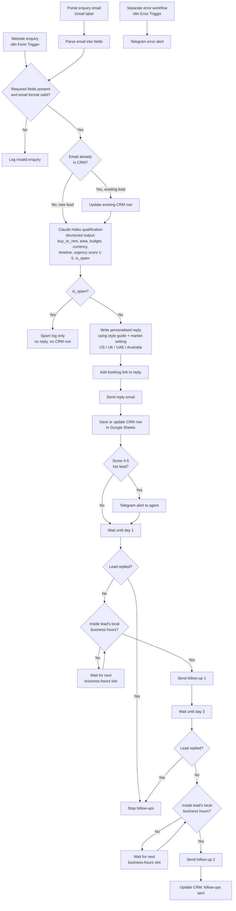

# P1 Property Lead Responder: Design

## Purpose

Real estate agencies lose leads because enquiries sit unanswered for hours. This automation replies to every property enquiry within minutes, in the right local wording (US, UK, UAE or Australia). It works out what the lead wants and how urgent it is, records it in a CRM sheet, and alerts the agent on Telegram when a lead is hot. It then follows up on day 1 and day 3 during the lead's local business hours, and stops as soon as the lead replies.

## Flow

Notes on the flow:

- **Two intake paths, one pipeline.** Form and email enquiries are converted to the same set of fields before validation.
- **Dedupe by email.** A repeat enquirer updates their existing row. No duplicate lead is created.
- **Spam is never answered.** It is written to a log only.
- **Replies stop follow-ups.** The reply check runs before every follow-up.
- **Errors are handled separately.** Any failing workflow triggers the error workflow, which sends a Telegram alert so nothing fails silently.

## CRM columns (Google Sheets)

| Column | Meaning |
|---|---|
| `lead_id` | Unique ID for the lead, generated on first contact. |
| `received_at` | When the enquiry arrived (UTC timestamp). |
| `source` | Where it came from: `form` or `portal_email`. |
| `country` | Lead's country, used to pick the market wording. |
| `timezone` | Lead's timezone, used for follow-up timing. |
| `name` | Lead's name. |
| `email` | Lead's email. Used to dedupe. |
| `phone` | Lead's phone number, if given. |
| `buy_or_rent` | Whether they want to `buy` or `rent`. |
| `area` | Suburb, city or area they are interested in. |
| `budget` | Budget amount as a number. |
| `currency` | Currency of the budget (USD, GBP, AED, AUD...). |
| `timeline` | When they want to move or decide. |
| `score` | Urgency score from 1 (cold) to 5 (very hot). |
| `status` | Lead stage: `new`, `replied`, `followed_up`, `closed`. |
| `reply_sent_at` | When the first reply email was sent. |
| `followup1_at` | When the day 1 follow-up was sent. |
| `followup2_at` | When the day 3 follow-up was sent. |
| `replied` | `TRUE` once the lead has answered, which stops follow-ups. |
| `agent_alerted` | `TRUE` once the agent has been alerted on Telegram (hot leads). |

## Test mode

Test mode is a single switch in the workflow settings. When it is on, **every email goes to my own test inbox** instead of the lead's real address, and Telegram alerts are marked as tests. This lets the full flow be run and shown safely without contacting real people.
